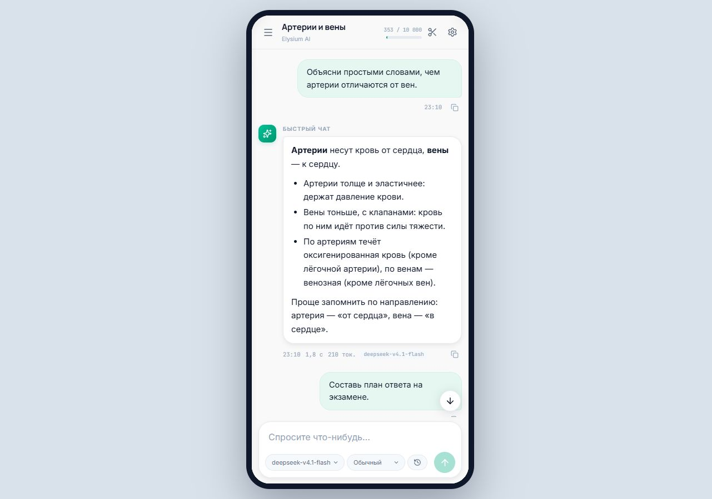
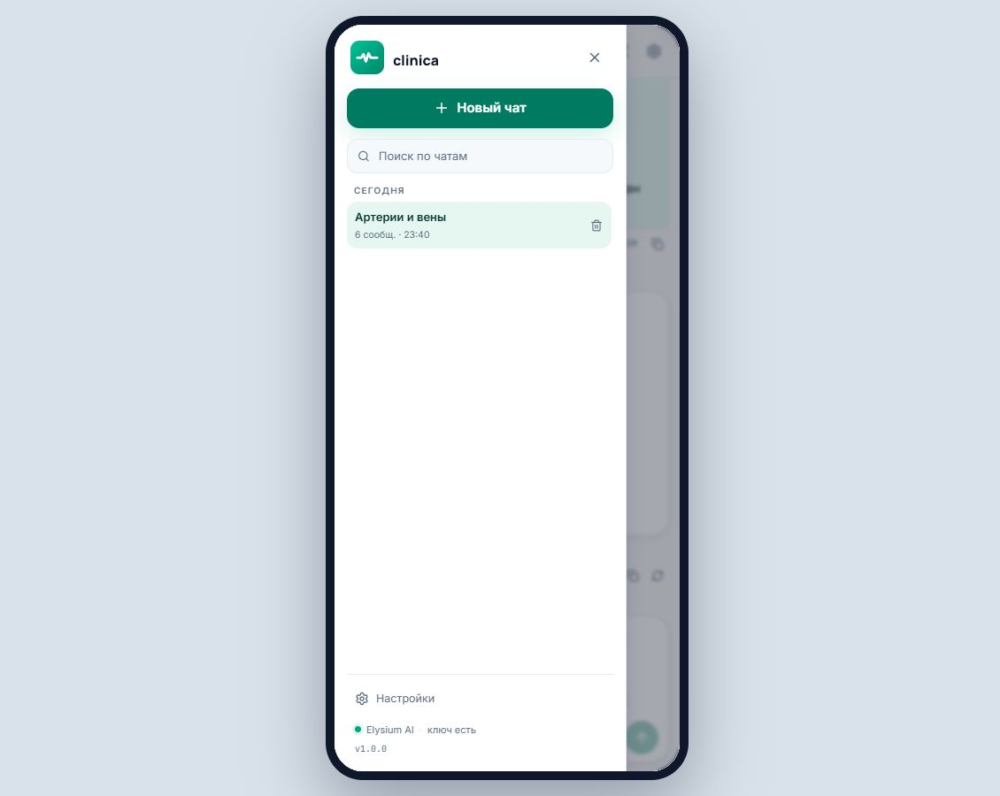

# Быстрый чат

Статическая PWA для DeepSeek и других OpenAI-совместимых API. Пользователь сам вводит
ключ, ключ хранится только в его браузере. Приложение открывается по ссылке, ставится
на экран «Домой» и работает как обычный чат: потоковый ответ, история, лимит контекста,
сжатие длинных диалогов.

Сервер для основной версии не нужен. Это важно: публичный сайт не может безопасно
хранить один общий ключ, поэтому каждый посетитель использует свой.

**Сайт:** https://bodyamafanya.github.io/fast-chat/  
**QR-код:** [Скриншоты/QR_ссылка.png](Скриншоты/QR_ссылка.png)  
**Дата:** 25.11.2026  
**Версия:** 1.0.0

---

## Скриншоты

| Компьютер | Телефон |
|---|---|
|  |  |

| Настройки | Меню на телефоне |
|---|---|
|  |  |

Скриншоты сняты с рабочего интерфейса. В демо-чате использована тестовая заглушка,
реальный ключ в кадр не попадает.

---

## Что умеет

| Возможность | Как работает |
|---|---|
| **Свой ключ API** | Пользователь вставляет ключ в настройках. Ключ лежит в `localStorage` браузера и уходит только на выбранный адрес API. |
| **Потоковый ответ** | Слова появляются по мере генерации, без ожидания всего ответа. |
| **Лимит контекста** | По умолчанию 10 000 токенов. Приложение не отправляет больше, старые сообщения обрезает и показывает, сколько не ушло. |
| **Сжатие истории** | Кнопка «Сжать историю» превращает старую часть диалога в краткое содержание. Оно заменяет старые сообщения в следующих запросах, а сами сообщения остаются в чате. |
| **Режимы ответа** | Обычный, кратко, просто, медицинский редактор, учёба, код. Режим меняет системную инструкцию для одного запроса. |
| **Без истории** | Переключатель в поле ввода отправляет только текущий вопрос. Это быстрее и экономнее. |
| **Markdown** | Заголовки, списки, таблицы, код и ссылки отображаются в ответе. |
| **История** | Чаты хранятся в браузере. Есть поиск по названиям, удаление и выгрузка в JSON. |
| **PWA** | Устанавливается на экран «Домой», оболочка кэшируется для офлайна. Запросы к API требуют интернет. |
| **Телефон** | Мобильная вёрстка, меню в шторке, крупные кнопки, безопасные отступы iPhone. |

---

## Быстрый старт

```bash
npm install
npm run dev
```

Откройте `http://localhost:5173`. При первом запуске откроются настройки: выберите
провайдера, вставьте ключ и проверьте подключение.

Сборка статической версии:

```bash
npm run build
```

Готовые файлы лежат в `dist`. Их можно выложить на GitHub Pages, Netlify, Cloudflare
Pages или любой статический хостинг с HTTPS.

---

## Провайдеры и ключи

В настройках есть готовые профили:

| Провайдер | Адрес API | Модель по умолчанию |
|---|---|---|
| **Elysium AI** | `https://elysiumai.garden/v1` | `deepseek/deepseek-v4.1-flash` |
| **DeepSeek** | `https://api.deepseek.com/v1` | `deepseek-chat` |
| **OpenCode** | `https://opencode.ai/inference/openai/v1` | `deepseek-v4.1-flash` |
| **Свой адрес** | любой OpenAI-совместимый | вводится вручную |

Для статической версии провайдер должен разрешать запросы из браузера (CORS).
Elysium, DeepSeek и OpenCode проверены: preflight проходит, ответы приходят.
OpenRouter в этой проверке preflight не разрешил, поэтому в список не добавлен.

Ключ хранится в `localStorage` под именем `fastchat.static.settings.v1`. История
чатов лежит в `fastchat.static.chats.v1`. Очистка данных сайта в браузере удалит и то,
и другое. Перед очисткой скачайте историю в JSON.

---

## Лимит контекста

Провайдеры считают токены по-разному, поэтому приложение показывает оценку со знаком
«≈», а точное число берёт из ответа API, если провайдер его присылает.

Алгоритм:

1. Из лимита вычитается максимум ответа и небольшой запас.
2. В запрос попадают системная инструкция, краткое содержание (если есть) и последние
   сообщения, пока они помещаются.
3. Старые сообщения не отправляются. Над чатом появляется строка, сколько сообщений
   не ушло.
4. Если не помещается даже текущий вопрос, приложение просит сократить текст или
   увеличить лимит.

Для тарифа с ограничением 10 000 токенов оставьте лимит 10 000. Для платного ключа
можно поднять до 16 000, 32 000, 64 000 или 128 000, если провайдер это разрешает.

Кнопка «Сжать историю» появляется, когда в чате не меньше четырёх сообщений. Она
делает отдельный запрос к модели и сохраняет краткое содержание. Старые сообщения
остаются видимыми, но в следующий запрос уходит только сводка и новые реплики.

---

## Публикация

### GitHub Pages

1. Создайте публичный репозиторий, например `fast-chat`.
2. Загрузите **содержимое** папки `dist` в корень репозитория, а не саму папку.
3. Откройте `Settings → Pages`.
4. Source: `Deploy from a branch`, Branch: `main`, папка `/ (root)`.
5. Через 1–2 минуты сайт будет доступен по адресу
   `https://ваш-логин.github.io/fast-chat/`.

Сборка использует относительные пути, поэтому работает и в корне, и в подпапке.
Проверено на `/fast-chat/`: манифест, иконки и service worker получают правильный
scope.

### Netlify Drop

1. Откройте `https://app.netlify.com/drop`.
2. Перетащите папку `dist` или ZIP с её содержимым.
3. Получите ссылку вида `https://...netlify.app`.

Главное, чтобы сайт открывался по HTTPS. Без HTTPS Safari не включит service worker
и офлайн-режим.

### Локальная проверка сборки

```bash
npm run preview
```

Откройте `http://localhost:4173`. Это тот же production-билд, что уедет на хостинг.

### Обновление версии

После изменений в коде:

1. Откройте `public/sw.js` и увеличьте номер кэша, например `fast-chat-v1` →
   `fast-chat-v2`.
2. Выполните `npm run build` и загрузите новое содержимое `dist` на хостинг.
3. На iPhone закройте и откройте приложение два раза, чтобы Safari подменил
   service worker и кэш.

Если номер кэша не менять, Safari может показывать старую версию.

---

## Установка на iPhone

QR-код для быстрого открытия лежит в `Скриншоты/QR_ссылка.png`.

1. Откройте ссылку **в Safari**, не в Chrome.
2. Нажмите «Поделиться» → «На экран Домой» → «Добавить».
3. Запускайте с иконки: без адресной строки, как обычное приложение.
4. Первый запуск должен быть онлайн, чтобы скачались оболочка и шрифты.
5. В настройках приложения вставьте свой ключ API.

Ключ и история хранятся в памяти Safari на телефоне. Они не синхронизируются с
компьютером. Если очистить данные сайта, ключ и чаты исчезнут.

На Android: Chrome → меню → «Установить приложение» или «Добавить на главный экран».

---

## Безопасность и приватность

- Ключ не входит в сборку и не лежит на сервере. Его вводит пользователь.
- Ключ уходит только на адрес API, который выбран в настройках.
- Приложение не отправляет телеметрию и не подключает сторонние скрипты.
- История и настройки лежат в `localStorage` браузера.
- Markdown рендерится без сырого HTML, поэтому ответ модели не может выполнить
  произвольный скрипт на странице.
- Не входите в приложение на чужом устройстве: владелец браузера сможет прочитать
  ключ через инструменты разработчика.
- Если сайт взломают или подменят скрипт, ключ может утечь. Для публичного сайта это
  обычный риск BYOK-схемы. При подозрении отзовите ключ у провайдера.
- Не вставляйте в чат паспортные данные, адреса пациентов и другую чувствительную
  информацию. Для медицинских вопросов приложение остаётся учебным помощником,
  а не врачом.

Если нужен один общий ключ для нескольких людей, статическая схема не подходит.
Тогда нужен серверный прокси, где ключ лежит в переменных окружения, а доступ
закрыт паролем или PIN.

---

## Архитектура

```text
fast-chat/
├── src/
│   ├── App.tsx                 ← состояние, чаты, поток, настройки
│   ├── api/
│   │   ├── client.ts           ← выбор режима: static или local
│   │   ├── static.ts           ← прямые запросы к API из браузера
│   │   ├── server.ts           ← запросы к локальному прокси
│   │   └── errors.ts           ← понятные ошибки API
│   ├── components/             ← чат, ввод, настройки, PIN, телефон
│   ├── lib/                    ← токены, формат, baseUrl
│   └── styles.css              ← дизайн-система clinica
├── server/                     ← необязательный локальный прокси
├── public/
│   ├── icons/                  ← иконки PWA
│   ├── licenses/               ← тексты OFL
│   ├── manifest.webmanifest
│   └── sw.js
├── scripts/
│   ├── mock-provider.mjs       ← заглушка API для проверки
│   ├── smoke.mjs               ← проверка локального сервера
│   ├── make_icons.py           ← иконки PWA
│   └── build-portable.mjs      ← portable .exe для локального режима
├── Скриншоты/
└── README.md
```

### Статический режим (основной)

`src/api/static.ts` вызывает выбранный API напрямую:

- `GET /models` для списка моделей;
- `POST /chat/completions` с `stream: true` для ответа;
- `POST /chat/completions` без потока для сжатия истории.

Настройки и чаты хранятся в `localStorage`. Ключ не покидает браузер, кроме запросов
к выбранному провайдеру.

### Локальный режим (необязательный)

В папке `server/` остался маленький локальный прокси. Он нужен, если хочется держать
ключ на компьютере, а не в браузере, и открывать чат по Wi-Fi с PIN и QR-кодом.

```bash
npm run dev:local
```

Сборка локальной версии и portable `.exe`:

```bash
npm run build:local
npm run build:portable
```

Портативная папка `release/FastChat` содержит `FastChat.exe`, встроенный Node.js,
исходники сервера и `config/license.json`. Это отдельный сценарий, для публичной
PWA он не используется.

---

## Команды

| Команда | Что делает |
|---|---|
| `npm run dev` | Статическая PWA в режиме разработки, без сервера |
| `npm run build` | Production-сборка статической PWA в `dist` |
| `npm run preview` | Локальный просмотр production-сборки |
| `npm run typecheck` | Проверка TypeScript |
| `npm run mock` | Заглушка API на `http://127.0.0.1:9999/v1` |
| `npm run smoke` | Проверка локального сервера: поток, история, сжатие, ошибки, PIN |
| `npm run dev:local` | Локальный сервер + Vite, ключ на компьютере |
| `npm run build:local` | Сборка для локального сервера |
| `npm run build:portable` | Portable `.exe` для Windows |
| `python scripts/make_icons.py` | Пересобрать иконки PWA |

Для проверки статической версии без реального ключа:

```bash
# терминал 1
npm run mock

# терминал 2
npm run dev
```

В настройках выберите «Свой адрес», адрес `http://127.0.0.1:9999/v1`, ключ `test`,
модель `mock/chat`. Заглушка отвечает потоком и умеет возвращать ошибку 429, если в
вопросе есть слово `ОШИБКА`.

---

## Что проверено

- `npm run typecheck` проходит без ошибок.
- `npm run build` собирает статическую PWA, шрифты и иконки.
- `npm run smoke` проверяет локальный сервер: health, модели, поток, историю,
  сжатие, ошибку 429, обновление настроек, экспорт и смену PIN.
- Статическая версия проверена в Chromium: ключ, прямой запрос к Elysium/DeepSeek/
  OpenCode, поток, сжатие, ошибка 429, сохранение истории.
- Production-сборка проверена на `http://localhost:4173`: service worker активен,
  манифест и иконки отдаются, запросы к API не кэшируются.
- Сборка проверена в подпапке `/fast-chat/`: относительные пути, scope service worker
  и манифест работают.
- Мобильная вёрстка проверена в окне 390×844: чат, меню, настройки, поле ввода.
- Lighthouse на финальной сборке: **Accessibility 100, Best Practices 100, SEO 100.**
  Контраст текста и кнопок проверен по AA.

---

## Ограничения

- История и ключ живут в одном браузере. Синхронизации между устройствами нет.
- Нет загрузки PDF и DOCX. Вопросы и текст вставляются вручную.
- Нет RAG и поиска по документам. Для больших файлов нужен отдельный режим.
- Провайдер может ограничивать контекст, частоту запросов и доступные модели.
- Приложение не проверяет медицинские факты за врачом. Дозы, диагнозы и назначения
  проверяются по инструкции и клиническим рекомендациям.
- Публичный сайт с BYOK-схемой не защищает ключ от владельца браузера или подмены
  скрипта. Для чувствительных сценариев нужен серверный прокси.

---

## Лицензии

Шрифты Manrope, Inter и JetBrains Mono распространяются по SIL OFL. Тексты лицензий
лежат в `public/licenses`. Код приложения можно использовать и менять по усмотрению
владельца проекта. Условия API задаёт провайдер, а не приложение.

---

## План развития

1. Загрузка PDF/DOCX и локальный поиск по фрагментам.
2. Синхронизация истории через опциональный сервер.
3. Голосовой ввод и озвучка ответа.
4. Тёмная тема.
5. Публикация в GitHub Pages и QR-код на ссылку.
